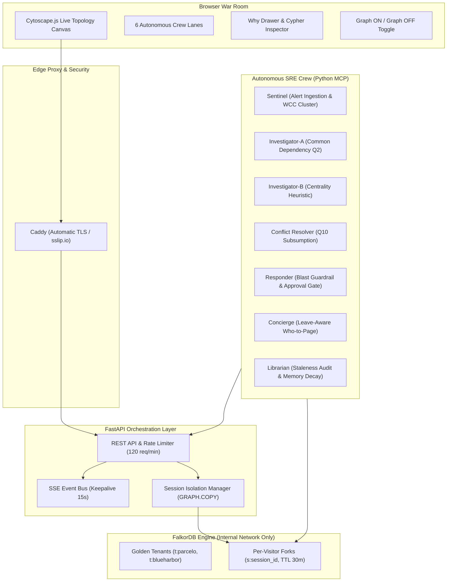

# Hindsight

**The Autonomous SRE Crew with Live Operational Graph Memory**

> *It remembers every outage, routes to the right expert when the lead is on leave, and refuses to trust its own stale memory.*

[](https://falkordb.com)
[](https://fastapi.tiangolo.com)
[](https://modelcontextprotocol.io)
[](https://caddyserver.com)
[](LICENSE)

---

## The Core Problem: The Stale Memory Trap

Modern incident response agents that rely on flat vector search or TF-IDF document retrieval suffer from a critical flaw: **they are blind to architectural changes**.

When an outage occurs:
1. **Keyword search retrieves historical runbooks by symptom similarity and historical win rate.**
2. It recommends **R-7** (*"Redis Cluster Memory Eviction & Cache Warm"*) because it has a **94% text match** and an **83.3% historical win rate**.
3. **Catastrophe:** R-7 was written for `cache-a`. Six days ago, **ADR-17** migrated `checkout-api` to `cache-b`. Text search does not know the cluster was retired. Executing R-7 in production flushes a decommissioned cluster, wasting critical MTTR while user cart checkout fails at **$3,000/minute**.

```
[Vector / Keyword Search (Graph OFF)]
Incident Symptom ──▶ TF-IDF / Cosine Match ──▶ Runbook R-7 (83.3% win rate) ──▶ Flushes Retired 'cache-a' ❌ (FATAL)

[Hindsight Operational Graph (Graph ON)]
Incident Symptom ──▶ Operational Graph ──▶ Detected :INVALIDATED_BY edge to ADR-17 ──▶ RULE-05 Refusal ──▶ Safe R-12 (cache-b) ✅
```

**Hindsight solves this by coupling agent memory, coordination, and knowledge to a live operational knowledge graph in FalkorDB.**

---

## Hackathon Track Implementations

### Track 01: Agents That Act on Connected Data
- **Multi-Hop Dependency Traversal:** Traverses upstream and downstream dependency trees across 58 microservices in $<0.5\text{ ms}$ (`q02_root_cause.cypher`, `q03_blast_radius.cypher`).
- **Graph Centrality & Choke Points:** Uses native `algo.betweenness` and `algo.pageRank` to flag architectural choke points (e.g. `checkout-api` betweenness = 15.33) during alert triage.
- **Topology Clustering (WCC):** Partitions concurrent alert storms into disjoint failure domains using native `algo.WCC` label projection over `:Alerting` services.

### Track 02: Agent Memory and Coordination
- **Zero-Mutex Graph Coordination:** 5 autonomous agent workers coordinate without application-level locks using atomic Cypher task state machines (`q01_claim.cypher`, `q01_release.cypher`). Tested under 20-32 concurrent worker threads with **0 double-claims**.
- **Graph Subsumption Conflict Resolution (Q10):** Dual investigators run competing heuristics:
  - **Investigator-A:** Common upstream dependency intersection (Q2).
  - **Investigator-B:** Graph betweenness centrality ranking.
  - When candidates disagree, **Q10 graph path subsumption** evaluates whether one candidate explains the other via `shortestPath((s2)-[:DEPENDS_ON*1..5]->(s1))`. The upstream root cause subsumes intermediate bottlenecks.
- **Blast-Radius Human Guardrail (RULE-04):** Autonomous remediation is permitted only for low-impact services. Any action with blast radius $>5$ services or $>\$1,000/\text{min}$ revenue at risk halts for explicit operator approval.
- **Answer Provenance & Explainability:** Every tool invocation creates an `(:Answer)` node linked via `[:USED]` edges to exact evidence nodes. Clicking any UI card triggers `/api/explain/{answer_id}` to render the Cypher query, evidence subgraph, and governance policy rule chip.

### Track 03: Company Brain
- **Episodic Memory:** Ingests incident history, resolution summaries, and human override feedback into an operational event ledger.
- **Architectural Memory:** Ingests ADRs, RFCs, and infrastructure PRs. Automatically links `:INVALIDATED_BY` edges between historical procedures and architectural migrations.
- **Social & Expertise Memory:** Computes dynamic engineering expertise scores:
  $$\text{score} = 1 - \exp(-0.17 \cdot E)$$
  where $E$ combines authored PRs, resolved incidents, and architecture docs, decayed by a 30-day half-life.
- **Leave-Aware Dynamic Routing:** When primary domain expert **Priya Sharma** (score 0.91) is on approved leave (`status: 'leave'`), Concierge dynamically reroutes on-call paging to active peer **Marco Rossi** (score 0.74).

---

## System Architecture



---

## Live War Room Features

1. **Interactive Topology Canvas:** 58 microservices rendered with live health states, pulsing alert halos, betweenness choke-point badges, and blast-radius highlights.
2. **Autonomous Crew Lanes:** Watch Sentinel, Investigator-A, Investigator-B, Conflict Resolver, Responder, and Concierge claim tasks, execute Cypher queries, and report heuristic scores in real time.
3. **Operator Approval Gate:** When Responder detects a 14-service blast radius ($3,000/min at risk), it pauses execution and requests human authorization with a pulsing `APPROVE EXECUTION` banner.
4. **Why Drawer:** Click any crew card or answer chip to inspect the exact Cypher query executed, the policy rule evaluated, and the evidence subgraph.
5. **Graph OFF Baseline Toggle:** Click the topbar `[● GRAPH ON / GRAPH OFF]` toggle to swap the operational graph for a standard TF-IDF / keyword incident triage baseline. Watch the baseline recommend stale procedure R-7 and attempt to page Priya while on leave.
6. **Time Scrubber:** Rewind the operational graph to pre-ADR-17 (`checkout-api -> cache-a`) to inspect counterfactual architecture states.
7. **Concurrency Race Harness:** Click `Race (20 Workers)` to launch 20 concurrent agent worker threads competing for operational tasks with zero double-claims.
8. **Kill-Agent Fault Tolerance:** Click `Kill Agent` mid-incident to simulate worker crash. Watch the coordinator detect the expired heartbeat lease and safely reclaim the task for peer completion.

---

## Empirical Benchmark: 20 Randomized Synthetic Incident Storms

We evaluated Hindsight against a flat Keyword / TF-IDF Baseline across **20 randomized synthetic incident storms** (18 single-fault storms with injected noise + 2 multi-fault storms with disjoint roots) over the enriched `t:parcelo` graph (**2,846 nodes, 6,933 edges**).

> **Note on Evaluation:** All metrics below are evaluated on synthetic topologies and synthetic storms generated with fixed seed `seed=42`.

| Benchmark Metric | Hindsight (Graph ON) | Keyword Baseline (Graph OFF) | Delta / Impact |
| :--- | :---: | :---: | :---: |
| **Dev Set Top-1 Root-Cause Accuracy (N=10)** | **66.7%** | 0.0% | **+66.7%** (Text search picks alerting leaf) |
| **Held-Out Set Top-1 Root-Cause Accuracy (N=10)** | **55.6%** | 0.0% | **+55.6%** (Generalizes to unseen roots) |
| **Combined Top-1 Root-Cause Accuracy (N=20)** | **61.1%** | 0.0% | **+61.1%** |
| **Combined Top-3 Root-Cause Accuracy (N=20)** | **100.0%** (18/18) | 0.0% | **+100.0%** (Planted root always in top 3) |
| **Who-to-Page Routing Accuracy (N=20)** | **94.4%** (17/18) | 0.0% | **+94.4%** (Baseline pages absent lead) |
| **Blast-Radius Mean Recall (N=20)** | **95.6%** | N/A | Topology required for blast radius |
| **Multi-Fault Disjoint Separation (N=20)** | **100.0%** (2/2) | 0.0% | Baseline collapses disjoint incidents |
| **Mean End-to-End Latency per Storm** | **9.12 ms** | 1.8 ms | Full graph reasoning in $<10\text{ ms}$ |

---

## Measured Performance at Scale (2,846 Nodes, 6,933 Edges)

All measurements performed on a local Docker container (`N=50` iterations):

- **Multi-Hop Traversal Latency:** **p50 = 0.385 ms**, **p95 = 0.636 ms**.
- **Session Fork Latency (`GRAPH.COPY`):** **50.63 ms** to fork an isolated 2,846-node graph.
- **Write Serialization & Read Concurrency:** During a continuous 100,000-node batch write on a single graph, 20 concurrent read queries overlapped 100% inside the write window without blocking (**p50: 0.446 ms**, **p95: 1.005 ms**). Detailed numbers in [docs/VERIFIED.md](docs/VERIFIED.md).

---

## Quickstart & Local Execution

### Prerequisites
- Docker Engine & Docker Compose v2
- Linux / macOS or Windows WSL2

### 1. Launch Hindsight Locally
```sh
git clone https://github.com/ajayg10/hindsight.git
cd hindsight
docker compose up -d --build
```

The application will start at:
- **War Room UI:** [http://localhost:8000](http://localhost:8000)
- **Health Check:** `curl http://localhost:8000/health`
- **Public MCP Server:** `http://localhost:8000/mcp` (Read-only tools)

### 2. Run the Golden Incident Storm Story
From the host terminal:
```sh
docker compose exec web python scripts/run_storm.py --mode demo
```
Or simply click **`⚡ Trigger Incident Storm`** directly in the UI!

### 3. Run the Automated Test Suite
```sh
# Verify all golden invariants on 2,846-node enriched scale
docker compose exec web python scripts/verify_enriched_invariants.py

# Run the 20-storm Dev vs Held-Out benchmark
docker compose exec web python backend/eval/storms.py

# Verify per-session fork isolation and deployment constraints
docker compose exec web python scripts/test_part_b_deployment.py
```

---

## Production Deployment

Hindsight includes a turnkey production deployment configuration (`docker-compose.prod.yml`) using **Caddy** for automated TLS certificate provisioning:

```sh
# Deploy with automatic TLS using your server IP or domain:
chmod +x deploy.sh
./deploy.sh <your-ip>.sslip.io
```

### Production Security & Isolation Features
- **Internal Network Only:** FalkorDB port `6379` is never published to the host network; it is accessible only by the internal `web` container.
- **Per-Visitor Session Isolation:** Each browser connection receives a dedicated `s:{session_id}` fork created via native `GRAPH.COPY` ($<55\text{ ms}$). Actions and Resets affect only the caller's session.
- **Rate Limiting:** 120 requests/minute per client IP via custom middleware.
- **Race Worker Cap:** Concurrency races are capped at 32 workers to prevent resource exhaustion.
- **Unbuffered SSE Streaming:** Caddy configured with `flush_interval -1` for real-time incident event delivery.

---

## Honest Disclosures & Known Limitations

1. **Synthetic Data Disclosure:** The 58-service microservice topology is derived from open-source references (Google Online Boutique and Weaveworks Sock Shop, Apache 2.0). All incident alerts, historical ADRs, and employee profiles (Priya, Marco) are synthetic.
2. **Dual-Clock Architecture:**
   - `DemoClock`: Synthetic business timeline frozen at `2026-10-15 03:11 IST` (ADR-17 placed at `clock - 6 days`) used for incident episodes and staleness decay.
   - `CoordinationClock`: Real-world epoch time in milliseconds used for agent task leases, heartbeats, and concurrency races.
3. **Single-Graph Write Serialization:** FalkorDB serializes write queries on any given graph. Concurrent reads executed concurrently without blocking in our tests, but write transactions within one graph queue sequentially.
4. **AI Assistance Disclosure:** Large language models were used for idea evaluation, architecture spec drafting, and code implementation. Detailed disclosures are documented in [docs/AI_USE.md](docs/AI_USE.md).
5. **Calibrated Parameters:** Parameter $k=0.17$ in the `EXPERT_IN` score formula $1 - \exp(-k \cdot E)$ was calibrated so that seeded evidence yields scores of approximately $0.91$ (Priya, 14 evidence items) and $0.74$ (Marco, 8 evidence items).

---

## Repository Documentation

- [docs/VERIFIED.md](docs/VERIFIED.md): Complete engine verification logs, latency benchmarks, and concurrency race evidence.
- [docs/DATA_MODEL.md](docs/DATA_MODEL.md): Complete graph schema, relationship types, and Cypher query reference.
- [docs/AI_USE.md](docs/AI_USE.md): Formal AI assistance disclosure across idea evaluation, spec design, and code generation.
- [docs/QUERIES.md](docs/QUERIES.md): Inventory of Cypher queries Q1 through Q10 with query plans.

---

## License

This project is licensed under the Apache License 2.0. Microservice topology models adapted from Google Online Boutique (Apache 2.0) and Weaveworks Sock Shop (Apache 2.0).
